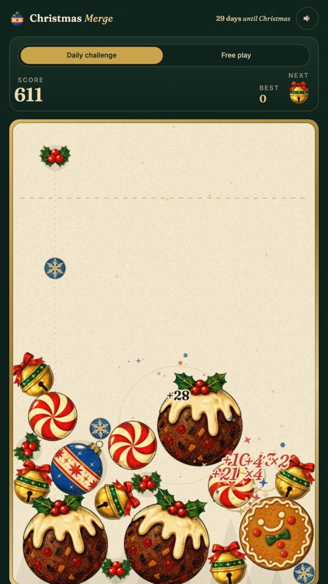
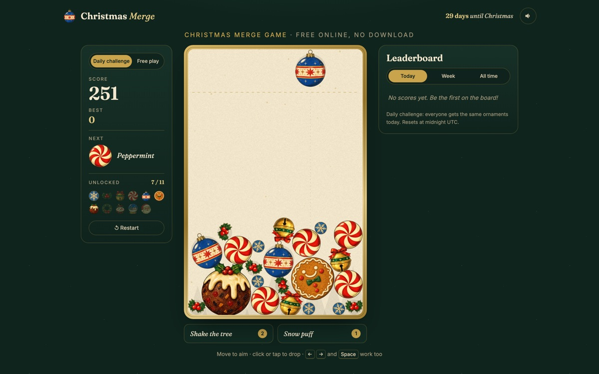

I made a small holiday game for the weeks before Christmas: **[Christmas Merge](https://christmasmerge.com)**. Drop festive ornaments, merge matching pairs, and work your way up from a tiny snowflake to Santa himself. It's free, runs right in your browser and needs no download or account, so it works on phones, tablets, Chromebooks and computers.

{: w="360" }
_One drop set off a four-merge chain_

## How to play

1. **Aim.** Move your mouse or finger to choose where the next ornament falls.
2. **Drop.** Click, tap or press Space. Ornaments roll, bounce and stack like the real thing.
3. **Merge.** When two identical ornaments touch, they merge into the next, bigger one and you score points.
4. **Chain combos.** When one drop sets off several merges in a row, each extra merge in the chain is worth 35% more.
5. **Don't overflow.** If the pile stays above the dashed gold line for two seconds, the tree is full and the game ends.

Each game you also get two **Shake the tree** nudges and one **Snow puff** that blows a small ornament away, for when you're stuck.

## The merge chain: from snowflake to Santa

There are eleven ornaments in all. Only the first five ever fall from the sky; everything bigger has to be merged.

_Snowflake → Holly → Sleigh Bell → Peppermint → Glass Bauble → Gingerbread → Plum Pudding → Wreath → Snowman → Snow Globe → Santa_

Merge two Santas and both vanish in a burst of gold for a big bonus, which is also the best way to free up room late in the game.

## Daily challenge and leaderboard

In **Daily challenge** mode everyone gets the same sequence of ornaments for the day, so the **Today** leaderboard is a fair race. It resets at midnight UTC. There are also Week and All-time boards, and a **Free play** mode if you just want to relax. After a game you can make a share card and challenge your family to beat your score.

_On desktop, the leaderboard sits right next to the game_

## Tips for a higher score

- Keep the biggest ornaments in one corner and build the chain downwards next to them.
- Check the **Next** ornament before you drop, so the current one doesn't block its partner.
- Small pieces are slippery. Use them to fill gaps instead of stacking them on top.
- Leave matching pairs close together. One merge can set off a whole chain.

## FAQ

**Is Christmas Merge free?** Yes, completely free, with no download and no account.

**Does it work on phones?** Yes. Drag your finger to aim and lift it to drop.

**How is it different from the watermelon game?** The drop-and-merge idea is similar, but Christmas Merge has its own hand-printed holiday chain of eleven ornaments, a daily seeded challenge and a festive leaderboard.

**Anything to do away from the screen?** If you like the ornaments, my other site Trazia has [free printable Christmas coloring pages](https://trazia.art/coloring-pages/christmas-tree) for a screen break.

Play now at <https://christmasmerge.com> and see if you can reach Santa. 🎅
