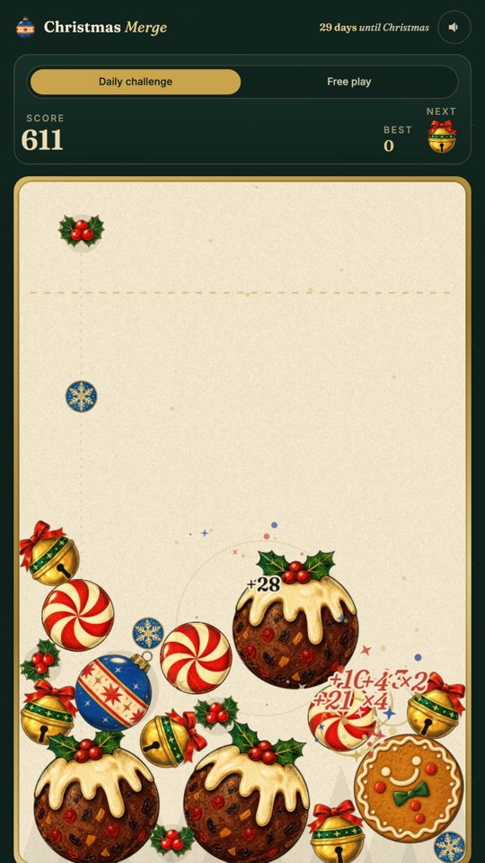
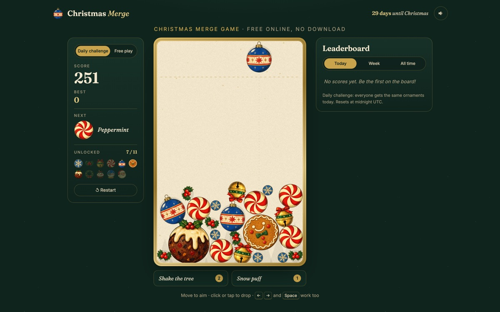

圣诞节前做了个小游戏：**[Christmas Merge](https://christmasmerge.com)**。掉落圣诞装饰，两个一样的碰到就合成更大的一个，从一片小雪花一路合到圣诞老人。免费，打开浏览器就能玩，不用下载也不用注册，手机、平板、电脑都可以。

{: w="360" }
_一次掉落，连着合成了 4 次_

## 怎么玩

1. **瞄准**：移动鼠标或手指，选好下一个装饰落在哪。
2. **掉落**：点击、轻触或按空格。装饰会滚动、弹跳、堆叠，跟真的一样。
3. **合成**：两个相同的装饰碰到一起，就合成下一级更大的，同时得分。
4. **连锁连击**：一次掉落连续触发多次合成，链条里每多一次合成，得分多 35%。
5. **别溢出**：装饰堆在金色虚线以上超过两秒，树就满了，游戏结束。

每局还有两次 **Shake the tree**（摇一摇）和一次 **Snow puff**（吹走一个小装饰），卡住的时候用。

## 合成链：从雪花到圣诞老人

一共 11 种装饰。只有前 5 种会从天上掉下来，更大的都得靠合成。

_雪花 → 冬青 → 雪橇铃 → 薄荷糖 → 玻璃彩球 → 姜饼 → 圣诞布丁 → 花环 → 雪人 → 水晶球 → 圣诞老人_

两个圣诞老人合在一起会化作一团金光消失，拿一大笔奖励分，也是后期腾地方最好的办法。

## 每日挑战和排行榜

**每日挑战**模式下，所有人当天拿到的装饰顺序都一样，所以**今日榜**是公平比赛，每天 UTC 零点（北京时间早上 8 点）重置。另外还有周榜和总榜。只想放松就玩**自由模式**。打完一局可以生成分享卡片，发给家人朋友比一比。

_电脑上排行榜就在游戏旁边_

## 高分小技巧

- 把最大的装饰放在一个角落，挨着它往下排合成链。
- 掉落前看一眼**下一个**是什么，别让现在这个挡住它的搭档。
- 小装饰很滑，拿来填缝，别往顶上堆。
- 相同的装饰尽量挨着放，一次合成可能引发一整串连锁。

## 常见问题

**免费吗？** 完全免费，不用下载，不用注册。

**手机能玩吗？** 能。手指拖动瞄准，松手掉落。

**和合成大西瓜有什么不同？** 掉落合成的玩法类似，但 Christmas Merge 有自己的一套复古版画风圣诞装饰合成链（11 级）、每天固定序列的每日挑战和节日排行榜。

**想离开屏幕歇一会？** 喜欢这些装饰的话，我的另一个站 Trazia 有[免费可打印的圣诞涂色页](https://trazia.art/coloring-pages/christmas-tree)。

现在就去玩：<https://christmasmerge.com>，看看你能不能合出圣诞老人。🎅
